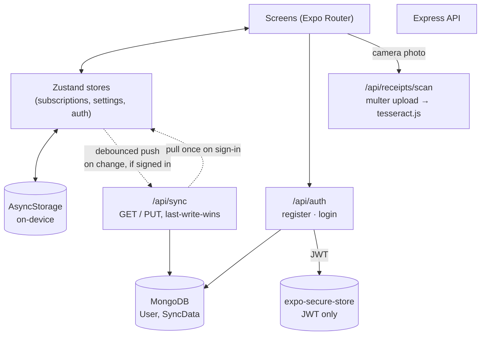
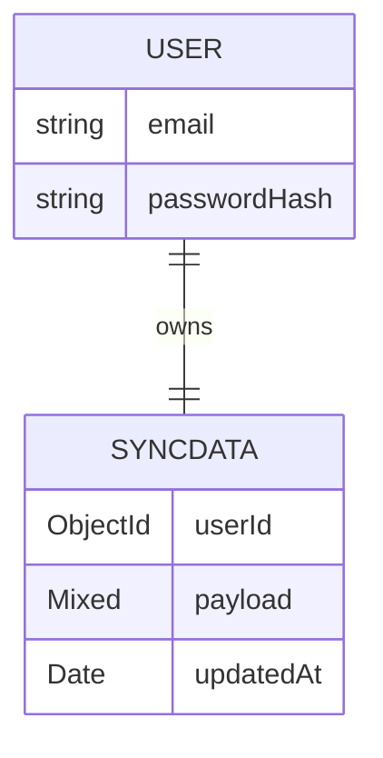
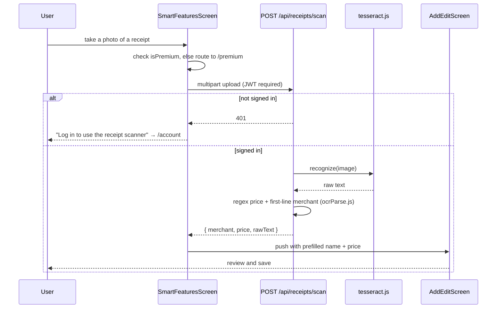

# Dueline

**An offline-first subscription tracker for React Native (Expo), with a Node/Express/MongoDB backend for optional cross-device sync.** Dueline tracks what you pay for — trials, renewal dates, price history, categorized spend — entirely on-device by default, and layers a premium tier on top: budget alerts, a yearly report, bill splitting with other people, a receipt scanner, bank-statement import, and extra themes/app icons, synced across devices once a user signs in.

      

---

### Contents

[What this is](#what-this-is) · [At a glance](#at-a-glance) · [Architecture](#architecture) · [The data model](#the-data-model) · [Offline-first sync](#offline-first-sync-last-write-wins) · [Receipt scanning & statement import](#receipt-scanning--statement-import) · [Free vs. Premium](#free-vs-premium) · [Also in the box](#also-in-the-box) · [Getting started](#getting-started) · [Project structure](#project-structure)

## What this is

A user adds the subscriptions they pay for — name, price, billing cycle, category, renewal date — and Dueline tracks the rest: days until renewal, price-change history, total spend to date, trial end dates, and per-subscription reminders. Reports break spend down by category and by month; a budget limit triggers an in-app banner and a local push notification the moment monthly spend crosses it. A shared subscription can be split between named people with an equal or custom share, and Dueline tracks who's paid.

The free tier works fully offline with zero account required — local storage only, capped at 5 subscriptions. Premium removes that cap and unlocks the budget limit, the yearly report, bill splitting, a camera-based receipt scanner, bank-statement (CSV) import, extra color themes, and alternate app icons. Signing in additionally turns on cloud sync, backed by the included Express/MongoDB API, so the same data follows a user across devices.

## At a glance

| | |
|---|---|
| **Frontend** | Expo Router (file-based routing), Zustand + AsyncStorage for state, a hand-built neumorphic design system — 15 components, no UI library dependency |
| **Charts** | Hand-built SVG bar/donut charts (`components/neu/BarChart`, `DonutChart`) — no charting library |
| **Backend** | Express + Mongoose, JWT auth, a single `/api/sync` endpoint doing last-write-wins sync of the whole app state |
| **OCR** | Receipt photos are uploaded and read server-side with `tesseract.js`; bank statements are parsed entirely on-device and never leave the phone |
| **Offline-first** | Every screen works with zero network access; cloud sync is additive, not required |
| **Tests** | 17 automated tests (4 suites) — pure-logic unit tests on the frontend, an integration suite against a real in-memory MongoDB on the backend |
| **Native modules** | Camera/library picker, document picker, secure token storage, local notifications, dynamic app icon switching |

## Architecture

The app is local-first: every screen reads and writes directly to Zustand stores persisted in `AsyncStorage`, so it's fully usable with no backend running at all. The Express API only comes into play for three things — auth, pushing/pulling the sync payload, and OCR'ing a receipt photo — none of which block the rest of the app.



`useCloudSync(enabled)` is the only place sync logic lives: it pulls the stored payload once on sign-in, then subscribes to the `subscriptions` and `settings` stores and pushes a debounced (1.5s) snapshot on every change. Nothing else in the app knows sync exists — toggling it off just unsubscribes.

## The data model

A `Subscription` is the only entity of real substance in the app; everything else (reports, budgets, reminders) is derived from the list of them:

```ts
type Subscription = {
  id: string; name: string; initials: string; color: string;
  price: number; currency: string;
  cycle: 'weekly' | 'monthly' | 'yearly' | 'custom';
  category: 'Streaming' | 'Music' | 'Cloud' | 'Productivity' | 'Gaming' | 'Fitness' | 'News' | 'Other';
  nextRenewal: string; status: 'active' | 'trial' | 'cancelled';
  isTrial?: boolean; trialEndsAt?: string; priceAfterTrial?: number;
  reminderDays: number[];
  priceHistory: { date: string; price: number }[];
  paymentHistory: string[];
  totalSpent: number; createdAt: string;
  isShared?: boolean;
  splitMembers?: { id: string; name: string; share: number; paid: boolean }[];
};
```

On the backend, `SyncData` stores this entire array (plus a small `settings` blob — currency, premium flag, budget limit) as one opaque JSON document per user:



There's deliberately no per-subscription schema on the server — `payload` is whatever the client's Zustand state looked like at push time. That keeps the backend trivial and the client free to evolve its own shape without a migration, at the cost of no server-side validation of subscription data; the trade-off is fine because the server never reads the data, only stores and returns it.

## Offline-first sync: last-write-wins

Cloud sync is intentionally the simplest model that's still correct for a single-user app used on one device at a time: `PUT /api/sync` fully replaces the stored payload, and `GET /api/sync` returns whatever was last written. There's no field-level merge and no conflict resolution — the last device to push wins outright. For a personal finance-adjacent app where a user is rarely editing the same subscription on two devices in the same second, that's a deliberate simplicity trade-off, not an oversight; a CRDT or operational-transform layer would be solving a problem this app doesn't have yet.

Signing in is never required to use the app. `useAuthStore` persists only a JWT and the user's email (via `expo-secure-store`, not plain `AsyncStorage`, since it's a credential); every other store stays exactly as it was for an anonymous user.

## Receipt scanning & statement import

Two different "import a subscription" flows, deliberately built with different trust boundaries:

- **Receipt scanner** — `expo-image-picker` captures a photo, which is uploaded to `POST /api/receipts/scan`. The server runs it through `tesseract.js`, then a small heuristic (`server/src/utils/ocrParse.js`) picks the largest dollar amount on the receipt as the price and the first non-trivial line as the merchant name, and returns both to prefill the Add Subscription form. This is the one place a user's data leaves the phone, and it's gated behind being signed in.
- **Statement import** — `expo-document-picker` picks a CSV/text export, which is parsed entirely on-device (`src/utils/statementParser.ts`): each line's dollar amount is extracted by regex, the remainder is matched against a list of known services for a clean display name, and the user reviews/deselects results before anything is saved. Nothing is uploaded.

Both are heuristics tuned for "good enough to prefill a form the user still reviews," not guaranteed-correct parsing — the UI treats every result as a draft, never an automatic import.



## Free vs. Premium

| | Free | Premium |
|---|---|---|
| Subscriptions tracked | 5 | Unlimited |
| Renewal reminders | ✓ | ✓ |
| Monthly spend & category breakdown | ✓ | ✓ |
| Budget limit + over-budget alert | — | ✓ |
| Yearly report + share | — | ✓ |
| Bill splitting | — | ✓ |
| Receipt scanner / statement import | — | ✓ |
| Extra themes & app icons | — | ✓ |
| Cloud sync across devices | — | ✓ (requires sign-in) |

The purchase flow in `PremiumScreen` is a local demo toggle — there's no App Store/Play Store receipt validation wired up. The premium flag still syncs through the same `/api/sync` payload once a user is signed in, so it isn't purely client-side once an account exists.

## Also in the box

- **Trials** — a dedicated tab for active free trials with a one-tap "keep" (converts to a paid subscription at its post-trial price) or cancel.
- **Cancel guides** — step-by-step, per-service cancellation instructions.
- **Calendar view** of upcoming renewals.
- **Local reminders** via `expo-notifications`, independent of any backend.
- **Backup & export** — write a backup file, export to CSV, or (demo) push to Google Drive, all local-file operations.
- **Dynamic app icon** via `expo-dynamic-app-icon`, switched alongside a named color theme (Classic/Ocean/Sunset) — both are runtime-switchable without reinstalling.

## Getting started

```bash
npm install
npx expo prebuild        # regenerates android/ and ios/ from app.json
npx expo run:android     # or: npx expo run:ios
```

The app runs fully offline at this point. To also run the backend (needed for cloud sync and the receipt scanner):

```bash
cd server
cp .env.example .env     # set MONGODB_URI and a JWT_SECRET
npm install
npm run dev              # http://localhost:4000

# point the app at it
cd ..
cp .env.example .env     # set EXPO_PUBLIC_API_BASE_URL
```

On a physical device connected over USB, forward the backend port instead of using a LAN IP: `adb reverse tcp:4000 tcp:4000`.

Run the test suites:

```bash
npm test            # frontend — Jest, pure-logic + store integration tests
cd server && npm test   # backend — Jest + Supertest against mongodb-memory-server
```

## Project structure

```
app/                    Expo Router routes — each file re-exports a screen from src/screens/
src/screens/            Screen implementations, one folder per feature area
src/components/neu/     The neumorphic design system (NeuSurface, NeuButton, charts, …)
src/store/              Zustand stores — subscriptions, settings, auth, transient import state
src/hooks/              useReportsData (shared report math), useCloudSync (sync lifecycle)
src/api/                Fetch wrappers for the backend (auth, sync, receipts)
src/data/               Static data — categories, popular-service presets, seed subscriptions, types
src/theme/              Theme tokens + the light/dark/named-theme context
server/src/
  models/               User, SyncData (Mongoose)
  routes/ controllers/  /api/auth, /api/sync, /api/receipts
  middleware/           JWT auth guard, error handler
  utils/ocrParse.js     Heuristic merchant/price extraction from OCR text
```
